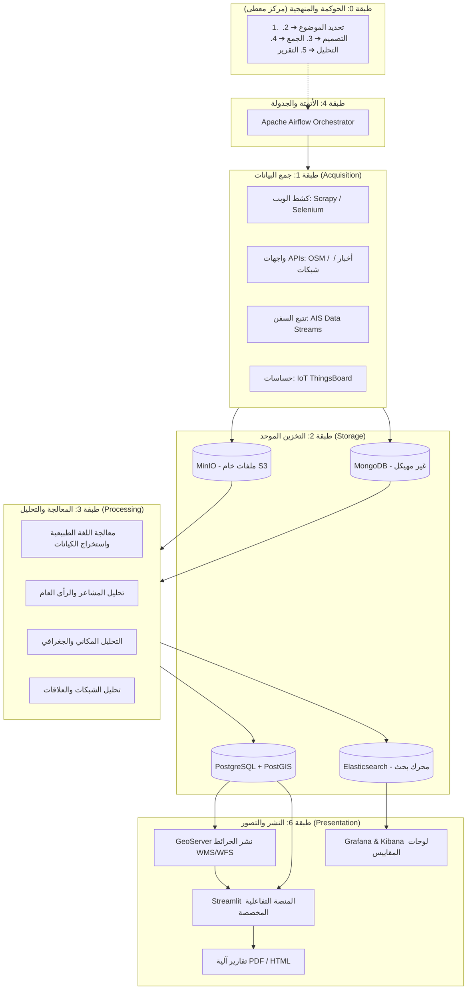

# 📋 الخطة التنفيذية الشاملة لتأسيس وتجهيز نظام الرصد العلني (OSINT Platform OX)
### من الألف إلى الياء — وفق منهجية مركز "معطى" والبنية المعمارية الموزعة

---

## 1. ملخص المشروع وميثاق العمل (Project Charter)

* **الهدف الاستراتيجي:** بناء منصة استخبارات ومراقبة مفتوحة المصدر (OSINT) متكاملة ومستقلة، تجمع وتخزن وتحلل البيانات المتعددة المصادر (ويب، شبكات تواصل، أقمار صناعية وبحرية، خرائط جغرافية، حساسات)، وتقدم رؤى استخباراتية فورية عبر لوحات تحكم وخرائط تفاعلية وتقارير آلية.
* **الأولوية التقنية:** الاعتماد الكامل على **البرمجيات الحرة ومفتوحة المصدر (FOSS)** للحد من التكاليف ومنع الارتهان التقني، مع توفير واجهات مرنة للترقية للحلول التجارية عند الحاجة.
* **الهوية والأصول البصرية:** اعتماد الشعار والأيقونات المتوفرة في المسار:
  `A:\platform_ox\imags` (`icon.png`, `svg/icon.svg`, `ico`, `xml`).

---

## 2. الهيكل الشجري الموسع الكامل للنظام (من الألف إلى الياء)

```text
نظام الرصد العلني (OSINT System)
│
├── 0. طبقة الحوكمة والمنهجية (Governance Layer)
│   ├── 0.1 منهجية مركز معطى (5 مراحل: تحديد الموضوع → التصميم → الجمع → التحليل → التقرير)
│   ├── 0.2 بروتوكولات العمل (الرصد، التحليل، التحقق، النشر)
│   ├── 0.3 أخلاقيات البحث والخصوصية
│   └── 0.4 مؤشرات الأداء (KPIs): عدد الشائعات المرصودة، دقة المعلومات، سرعة الاستجابة
│
├── 1. طبقة جمع البيانات (Data Acquisition Layer)
│   ├── 1.1 كشط الويب (Web Scraping)
│   │   ├── Scrapy (إطار عمل متكامل للكشط الواسع)
│   │   ├── Beautiful Soup (تحليل HTML/XML)
│   │   ├── Selenium (المواقع الديناميكية JavaScript)
│   │   ├── Requests (طلبات HTTP الأساسية)
│   │   └── Octoparse (كشط بصري بدون كود — بديل تجاري مجاني محدود)
│   ├── 1.2 واجهات برمجة التطبيقات (Public APIs)
│   │   ├── OpenStreetMap (OSM) — بيانات جغرافية مفتوحة
│   │   ├── Twitter API / Facebook Graph API (وسائل التواصل)
│   │   ├── بيانات الطقس، المرور، السكان
│   │   └── Google News / Feedly (تجميع الأخبار)
│   ├── 1.3 إنترنت الأشياء (IoT Platforms)
│   │   ├── ThingsBoard (منصة IoT مفتوحة المصدر)
│   │   └── OpenHAB (أتمتة المنزل/الاستشعار)
│   ├── 1.4 بيانات تتبع السفن البحرية (AIS)
│   │   ├── MarineTraffic API (بيانات AIS تجارية)
│   │   ├── AISLive (منصة تتبع السفن)
│   │   ├── Spire Maritime (بيانات استخبارات بحرية بالأقمار الصناعية)
│   │   └── VesselView (بيانات حركة السفن)
│   └── 1.5 أدوات الاستماع الاجتماعي (بدائل تجارية)
│       ├── Brandwatch
│       ├── Mention
│       ├── Hootsuite
│       ├── Sprout Social
│       └── Buffer
│
├── 2. طبقة التخزين (Data Storage Layer)
│   ├── 2.1 قاعدة البيانات العلائقية
│   │   ├── PostgreSQL (الخيار الأساسي)
│   │   ├── MySQL (بديل)
│   │   └── SQLite (مشاريع صغيرة)
│   ├── 2.2 قاعدة البيانات المكانية
│   │   └── PostGIS (إضافة PostgreSQL الجغرافية)
│   ├── 2.3 قاعدة البيانات غير العلائقية (NoSQL)
│   │   └── MongoDB (بيانات غير مهيكلة)
│   ├── 2.4 تخزين الكائنات
│   │   └── MinIO (متوافق مع S3)
│   └── 2.5 محرك البحث والفهرسة
│       └── Elasticsearch
│
├── 3. طبقة المعالجة والتحليل (Processing & Analysis Layer)
│   ├── 3.1 التحليل الإحصائي
│   │   ├── Python: NumPy, SciPy, Pandas, Statsmodels
│   │   ├── R Language
│   │   ├── SPSS (تجاري)
│   │   └── SAS (تجاري)
│   ├── 3.2 معالجة اللغة الطبيعية (NLP)
│   │   ├── NLTK
│   │   ├── spaCy
│   │   ├── BERT / Transformers
│   │   ├── IBM Watson NLU (سحابي تجاري)
│   │   └── Google Cloud Natural Language API (سحابي تجاري)
│   ├── 3.3 تحليل المشاعر (Sentiment Analysis)
│   │   ├── Vader Sentiment
│   │   └── TextBlob
│   ├── 3.4 التحليل الجغرافي المكاني (GIS)
│   │   ├── QGIS (سطح المكتب)
│   │   ├── GeoPandas (Python)
│   │   ├── GDAL/OGR (تحويل الصيغ)
│   │   ├── PySAL (تحليل مكاني إحصائي)
│   │   ├── ArcGIS (تجاري)
│   │   ├── MapInfo Pro (تجاري)
│   │   └── ESRI Geostatistical Analyst (إضافة تجارية)
│   └── 3.5 تحليل الشبكات الاجتماعية
│       ├── Gephi
│       └── NodeXL
│
├── 4. طبقة الأتمتة والجدولة (Orchestration & Automation)
│   ├── Apache Airflow (الجدولة الأساسية)
│   ├── Luigi (بديل Python لخطوط الأنابيب)
│   └── Cron (جدولة بسيطة)
│
├── 5. طبقة النشر والتشغيل (Deployment & DevOps)
│   ├── Docker (حاويات)
│   ├── Kubernetes (تنسيق الحاويات)
│   ├── Git (التحكم في الإصدارات)
│   ├── CI/CD (أتمتة البناء والاختبار والنشر)
│   ├── Nginx (خادم ويب / Reverse Proxy)
│   ├── Apache (خادم ويب بديل)
│   ├── Heroku / AWS / Google Cloud / DigitalOcean (استضافة)
│   └── Streamlit / Dash (واجهات تفاعلية خفيفة)
│
└── 6. طبقة التطبيقات والتصور (Application & Visualization)
    ├── 6.1 الخرائط وخدمات GIS
    │   └── GeoServer (نشر WMS/WFS)
    ├── 6.2 لوحات التحكم
    │   ├── Kibana (مع Elasticsearch)
    │   ├── Grafana (مقاييس في الوقت الفعلي)
    │   ├── Tableau (تجاري)
    │   └── Power BI (تجاري)
    ├── 6.3 التصور الإحصائي
    │   ├── matplotlib
    │   ├── seaborn
    │   ├── Plotly
    │   └── Jupyter Notebook (تقارير تفاعلية)
    ├── 6.4 أطر تطوير الويب
    │   ├── Flask (خفيف)
    │   └── Django (متكامل)
    └── 6.5 أنظمة إدارة المحتوى (CMS)
        ├── WordPress
        ├── Drupal
        └── Joomla
```

---

## 3. الهيكل التنظيمي لمجلدات المشروع البرمجية (`A:\platform_ox`)

تم تنظيم المشروع بنمط (Modular Architecture) متعدد الطبقات ليتطابق مع الشجرة الفنية ويسهل صيانته ونشره:

```text
A:\platform_ox\
│
├── 📁 imags/                      # الأصول البصرية والشعار (الأصلية)
│   ├── icon.png
│   ├── 📁 svg/ (icon.svg)
│   ├── 📁 ico/
│   └── 📁 xml/
│
├── 📁 00_governance/              # طبقة 0: الحوكمة والمنهجية
│   ├── methodology_moata.md       # منهجية مركز معطى الخماسية
│   ├── sop_protocols.md           # بروتوكولات الرصد، التحقق، النشر
│   ├── ethics_privacy.md          # ميثاق الأخلاقيات والخصوصية
│   └── kpi_framework.md           # مؤشرات الأداء والقياس
│
├── 📁 01_acquisition/             # طبقة 1: جمع البيانات
│   ├── 📁 scrapers/               # كشط الويب (Scrapy, BS4, Selenium)
│   ├── 📁 apis/                   # موصلات واجهات البرمجة (OSM, News, Social)
│   ├── 📁 maritime_ais/           # بيانات تتبع السفن البحرية
│   ├── 📁 iot_connectors/         # موصلات منصات ThingsBoard / OpenHAB
│   └── 📁 social_listening/       # سكربتات الاستماع ومراقبة المنصات
│
├── 📁 02_storage/                 # طبقة 2: التخزين
│   ├── 📁 postgres/               # إعدادات PostgreSQL + PostGIS وترحيلات الجداول
│   ├── 📁 mongodb/                # مخططات وفهارس البيانات غير المهيكلة
│   ├── 📁 minio/                  # تهيئة تخزين الملفات الخام (S3 Compatible)
│   └── 📁 elasticsearch/          # قوالب الفهرسة والبحث
│
├── 📁 03_processing/              # طبقة 3: المعالجة والتحليل
│   ├── 📁 nlp_engine/             # استخراج الكيانات وتصنيف النصوص (spaCy/BERT)
│   ├── 📁 sentiment/              # تحليل المشاعر (VADER, TextBlob, Transformers)
│   ├── 📁 spatial_gis/            # التحليل الجغرافي (GeoPandas, PySAL)
│   ├── 📁 network_analysis/       # تحليل الشبكات الاجتماعية والعلاقات
│   └── 📁 statistics/             # التحليلات الإحصائية وتوقعات السلاسل الزمنية
│
├── 📁 04_orchestration/           # طبقة 4: الأتمتة والجدولة
│   └── 📁 dags/                   # خطوط أنابيب تدفق البيانات عبر Airflow
│
├── 📁 05_devops/                  # طبقة 5: النشر والتشغيل
│   ├── docker-compose.yml         # تشغيل جميع الخدمات بأمر واحد
│   ├── 📁 nginx/                  # البوابة العكسية وإعدادات الأمان
│   ├── 📁 ci_cd/                  # أتمتة الاختبار والنشر
│   └── 📁 backups/                # نصوص النسخ الاحتياطي التلقائي
│
└── 📁 06_presentation/            # طبقة 6: التطبيقات والتصور
    ├── 📁 geoserver_data/         # مساحات عمل وطبقات الخرائط WMS/WFS
    ├── 📁 dashboards/             # قوالب Kibana و Grafana
    ├── 📁 streamlit_app/          # بوابة العرض التفاعلية المخصصة للمحلل
    │   ├── app.py
    │   └── assets/ (ربط بأيقونة icon.png)
    └── 📁 reporting/              # قوالب التقارير الآلية (Jupyter / Plotly)
```

---

## 4. المخطط المعماري وتدفق البيانات (System Architecture & Data Flow)



---

## 5. الخطة الزمنية المرحلية للتنفيذ (12 أسبوعاً)

### 🔹 المرحلة 0: الحوكمة والمنهجية (الأسبوع 1)
* **الهدف:** توحيد الإطار التشغيلي الميداني والأخلاقي والقانوني.
* **المهام:**
  1. صياغة وتثبيت **منهجية مركز معطى الخماسية** كإطار تشغيلي موحد:
     * **تحديد الموضوع:** معايير اختيار القضايا، الأحداث العاجلة، ورصد الشائعات.
     * **التصميم:** بناء معجم الكلمات الدلالية، تحديد النطاقات الجغرافية والمصادر الموثوقة.
     * **الجمع:** اختيار أدوات الكشط والقنوات وتحديد ترددات السحب.
     * **التحليل:** معايير الفرز، تدقيق المصادر، واستبعاد التشويش والتزييف.
     * **التقرير:** قوالب المخرجات (تقدير موقف، تقرير رصد عاجل، ملخص إحصائي).
  2. صياغة بروتوكولات العمل القياسية (SOPs): الرصد، التحليل، التحقق (Fact-Checking)، والنشر.
  3. اعتماد ميثاق أخلاقيات البحث والخصوصية والامتثال للقوانين.
  4. تحديد لوحة مؤشرات الأداء (KPIs): سرعة الرصد، دقة الكشف عن التضليل، ومعدل الاستجابة.
* **المخرج:** وثائق معتمدة في مجلد `00_governance`.

---

### 🔹 المرحلة 1: البنية التحتية الموحدة (الأسبوع 2 - 3)
* **الهدف:** تشغيل البنية التحتية البرمجية بالكامل بحزمة موحدة تعمل بأمر واحد.
* **المهام:**
  1. تجهيز ملف `docker-compose.yml` يضم:
     * **PostgreSQL + PostGIS (2.1 + 2.2):** لقواعد البيانات العلائقية والمكانية.
     * **MongoDB (2.3):** للبيانات غير المهيكلة ونتائج السحب السريع.
     * **MinIO (2.4):** كخزان للملفات الخام والوسائط واللقطات (متوافق مع S3).
     * **Elasticsearch + Kibana (2.5 + 6.2):** لفهرسة النصوص ومحرك البحث السريع.
     * **Apache Airflow (4):** لإدارة وجدولة خطوط الأنابيب (DAGs).
     * **GeoServer (6.1):** لنشر طبقات الخرائط والبيانات المكانية.
     * **Grafana (6.2):** لمراقبة أداء النظام والمقاييس اللحظية.
  2. إعداد مجلدات التخزين الدائم (Volumes) وتأمين شبكات الحاويات (Docker Networks).
  3. كتابة سكربتات التهيئة الأولية للجداول والمخططات الجغرافية.
* **المخرج:** بيئة موحدة تعمل بأمر واحد `docker-compose up -d`.

---

### 🔹 المرحلة 2: خط أنابيب الجمع الذاتي (الأسبوع 4 - 6)
* **الهدف:** أتمتة تدفق البيانات من المصادر المختلفة على مدار الساعة.
* **المهام:**
  1. برمجة وتجهيز أدوات كشط الويب (Scrapy / Beautiful Soup / Selenium).
  2. برمجة وحدات الاتصال بواجهات APIs (OpenStreetMap, أخبار Google, منصات التواصل).
  3. ربط وتفعيل موصل بيانات تتبع السفن البحرية (AIS Live Stream / Decoders).
  4. ربط موصلات إنترنت الأشياء (ThingsBoard / OpenHAB) عبر MQTT لاستقبال أي قراءات استشعار.
  5. برمجة الـ DAGs في Airflow لتشغيل أدوات الجمع بجدولة زمنية محددة.
  6. توجيه المخرجات الخام إلى MinIO والمخرجات المهيكلة الأولية إلى MongoDB و PostgreSQL.
* **المخرج:** تدفق بيانات تلقائي ومنتظم كل 15 دقيقة / كل ساعة.

---

### 🔹 المرحلة 3: خط أنابيب المعالجة والتحليل (الأسبوع 7 - 10)
* **الهدف:** استخراج المعرفة والاستخبارات القابلة للاستخدام من البيانات المجمعة.
* **المهام:**
  1. بناء خطوط معالجة اللغة الطبيعية (NLP):
     * تنظيف وتجريد النصوص العربية والإنجليزية.
     * استخراج الكيانات المسماة (NER) باستخدام `spaCy` ونماذج `BERT` (أشخاص، مواقع، جهات).
  2. بناء محرك تحليل المشاعر والآراء (Vader / TextBlob / Transformers).
  3. بناء محرك التحليل الجغرافي المكاني (GeoPandas + PySAL) وتخزين الطبقات في PostGIS.
  4. بناء محرك التحليل الإحصائي والسلاسل الزمنية (Statsmodels / SciPy).
  5. بناء خط تحليل شبكات العلاقات (SNA) لتصدير الرسوم البيانية التفاعلية لـ Gephi.
  6. أتمتة تدفق المعالجة في Airflow وفهرسة النتائج في Elasticsearch.
* **المخرج:** محتوى ذكي ومحلل ومفهرس جاهز للعرض والبحث الفوري.

---

### 🔹 المرحلة 4: النشر والتصور والتطبيقات (الأسبوع 11 - 12)
* **الهدف:** توفير واجهات وصول وتفاعل استخباراتية سهلة وقوية للمحللين.
* **المهام:**
  1. ربط `GeoServer` بـ PostGIS لنشر خرائط WMS/WFS تفاعلية.
  2. تجهيز لوحات تحكم Kibana للبحث النصي وتتبع الكلمات المفتاحية الحية.
  3. تجهيز لوحات Grafana لمراقبة التدفق اللحظي للبيانات وحركة السفن والنشاط الميداني.
  4. بناء واجهة ويب مخصصة للمنصة باستخدام **Streamlit**:
     * تضمين الهوية والأيقونة الرسمية من `A:\platform_ox\imags\icon.png`.
     * توفير خريطة أحداث تفاعلية، سجل رصد الشائعات، ومحلل المشاعر.
  5. إعداد نظام توليد التقارير التلقائي (Jupyter / WeasyPrint) لإصدار تقارير PDF استخباراتية موجزة.
* **المخرج:** منصة تفاعلية متكاملة + تقارير استخباراتية آلية + بوابات نشر رقمية.

---

### 🔹 المرحلة 5: الأتمتة، الأمان، والتشغيل المستمر (DevOps & Maintenance)
* **المهام المستمرة:**
  1. إعداد خادم `Nginx` كـ Reverse Proxy لتأمين كافة الواجهات بشهادات SSL ومصادقة الدخول.
  2. بناء خطوط CI/CD لفحص الكود وتحديث الحاويات تلقائياً عند التطوير.
  3. جدول مهام النسخ الاحتياطي اليومي لقواعد البيانات (PostgreSQL, MinIO).
  4. إعداد نظام مراقبة وتنبيهات فورية عند تعطل أي موقع مرصود أو تعطل خط سحب بيانات.

---

## 6. مصفوفة البدائل التجارية مقابل المفتوحة المصدر

| الوظيفة التقنية | مفتوح المصدر (الأساس المعتمد) | تجاري (بديل / ترقية مستقبلية) | استراتيجية التكامل في المنصة |
| :--- | :--- | :--- | :--- |
| **كشط الويب** | Scrapy, Beautiful Soup, Selenium | Octoparse, BrightData | الاعتماد على Scrapy؛ واللجوء لـ Selenium للمواقع المعقدة. |
| **الاستماع الاجتماعي** | Scrapy + APIs خاصة + Telethon | Brandwatch, Hootsuite, Mention, Sprout Social | سحب القنوات والوسوم ببروتوكولات مباشرة، مع توفير واجهة لربط API تجاري إذا توفرت ميزانية. |
| **التحليل الإحصائي** | Python (Statsmodels, SciPy), R | SPSS, SAS | استخدام Python و R داخل خطوط الأنابيب المؤتمتة مجاناً بالكامل. |
| **نظم المعلومات الجغرافية (GIS)** | PostGIS, GeoServer, GeoPandas, QGIS | ArcGIS Pro, MapInfo Pro | البنية مفتوحة بالكامل وقابلة لتبادل الطبقات الجغرافية مع برامج ArcGIS بصيغ Shapefile/GeoJSON. |
| **معالجة اللغة الطبيعية (NLP)** | spaCy, NLTK, HuggingFace BERT | IBM Watson NLU, Google Cloud NLP | تشغيل نماذج محلية تضمن استقلالية وسرية البيانات 100%. |
| **تحليل الشبكات** | NetworkX, Gephi, NodeXL | لا يوجد بديل تجاري بارز متفوق | معالجة العلاقات بـ NetworkX وتصدير ملفات GEXF للفتح في Gephi. |
| **قواعد البيانات** | PostgreSQL + PostGIS, MongoDB | Oracle Spatial, Snowflake | أداء عالي وتكلفة ترخيص صفرية مع دعم مكاني فائق. |
| **محرك البحث** | Elasticsearch | Splunk, Algolia | فهرسة وبحث دلالي فوري مجاني بالكامل. |
| **لوحات التحكم** | Streamlit, Kibana, Grafana | Tableau, Power BI | واجهات مصممة خصيصاً للمنصة مع إمكانية التصدير لـ Power BI إن لزم. |
| **تتبع السفن (AIS)** | NMEA Parsers + Open AIS Feeds | MarineTraffic, AISLive, Spire Maritime | معالجة الإشارات المتاحة وتوفير موصل مرن لأي API تجاري مدفوع. |
| **إنترنت الأشياء (IoT)** | ThingsBoard Community, OpenHAB | AWS IoT Core, Azure IoT | المنصات مفتوحة المصدر تمنح تحكماً كاملاً في الحساسات محلياً. |
| **الاستضافة والتشغيل** | Docker Compose + Linux/Windows | AWS, Azure, Google Cloud | بنية حاويات محمولة تعمل على أي خادم محلي أو سحابي بنفس السهولة. |
| **أنظمة إدارة المحتوى (CMS)** | WordPress, Drupal | منصات نشر تجارية مغلقة | النشر المباشر عبر WordPress REST API كبوابة إعلامية متصلة. |

---

## 7. تكوين البنية التحتية الأولي (`docker-compose.yml`)

لتشغيل المنصة بأمر واحد، هذا هو مخطط التكوين الأساسي الذي سيتم نشره في `05_devops/docker-compose.yml`:

```yaml
version: '3.8'

services:
  # 1. قاعدة البيانات العلائقية والمكانية
  postgres:
    image: postgis/postgis:16-3.4
    container_name: osint_postgres
    restart: always
    environment:
      POSTGRES_DB: osint_platform
      POSTGRES_USER: osint_admin
      POSTGRES_PASSWORD: ${DB_PASSWORD:-SecureOsintPass2026}
    ports:
      - "5432:5432"
    volumes:
      - pgdata:/var/lib/postgresql/data

  # 2. قاعدة البيانات غير المهيكلة
  mongodb:
    image: mongo:7.0
    container_name: osint_mongo
    restart: always
    ports:
      - "27017:27017"
    volumes:
      - mongodata:/data/db

  # 3. تخزين الملفات والوسائط الخام (S3 Compatible)
  minio:
    image: minio/minio:latest
    container_name: osint_minio
    restart: always
    command: server /data --console-address ":9001"
    environment:
      MINIO_ROOT_USER: minio_admin
      MINIO_ROOT_PASSWORD: ${MINIO_PASSWORD:-MinioSecret2026}
    ports:
      - "9000:9000"
      - "9001:9001"
    volumes:
      - miniodata:/data

  # 4. محرك البحث والفهرسة
  elasticsearch:
    image: docker.elastic.co/elasticsearch/elasticsearch:8.13.0
    container_name: osint_elasticsearch
    restart: always
    environment:
      - discovery.type=single-node
      - xpack.security.enabled=false
      - "ES_JAVA_OPTS=-Xms1g -Xmx1g"
    ports:
      - "9200:9200"
    volumes:
      - esdata:/usr/share/elasticsearch/data

  # 5. لوحة البحث والتحليل النصي
  kibana:
    image: docker.elastic.co/kibana/kibana:8.13.0
    container_name: osint_kibana
    restart: always
    environment:
      - ELASTICSEARCH_HOSTS=http://elasticsearch:9200
    ports:
      - "5601:5601"
    depends_on:
      - elasticsearch

  # 6. خادم الخرائط الجغرافية
  geoserver:
    image: kartoza/geoserver:latest
    container_name: osint_geoserver
    restart: always
    ports:
      - "8085:8080"
    environment:
      - GEOSERVER_ADMIN_PASSWORD=${GEOSERVER_PASSWORD:-GeoServerPass2026}
    volumes:
      - geodata:/opt/geoserver/data_dir
    depends_on:
      - postgres

  # 7. لوحة مقاييس الأداء والمراقبة
  grafana:
    image: grafana/grafana:latest
    container_name: osint_grafana
    restart: always
    ports:
      - "3000:3000"
    volumes:
      - grafanadata:/var/lib/grafana

  # 8. البوابة التفاعلية المخصصة للمحلل (Streamlit)
  streamlit_ui:
    build:
      context: ../06_presentation/streamlit_app
    container_name: osint_ui
    restart: always
    ports:
      - "8501:8501"
    volumes:
      - ../06_presentation/streamlit_app:/app
      - ../imags:/app/assets/branding:ro
    depends_on:
      - postgres
      - elasticsearch

volumes:
  pgdata:
  mongodata:
  miniodata:
  esdata:
  geodata:
  grafanadata:
```

---

## 8. الخطوات الفورية للمباشرة في التنفيذ

1. **اعتماد هذه الخطة التنفيذية كمرجع رئيسي.**
2. **إنشاء هيكل المجلدات الفعلي في بيئة العمل `A:\platform_ox`.**
3. **نسخ وربط الأصول البصرية (`A:\platform_ox\imags`) بالواجهات.**
4. **كتابة وثائق الحوكمة ومنهجية معطى في مجلد `00_governance`.**
5. **توليد ملفات البنية التحتية والتشغيل في مجلد `05_devops` والبدء في رفع الحاويات.**
